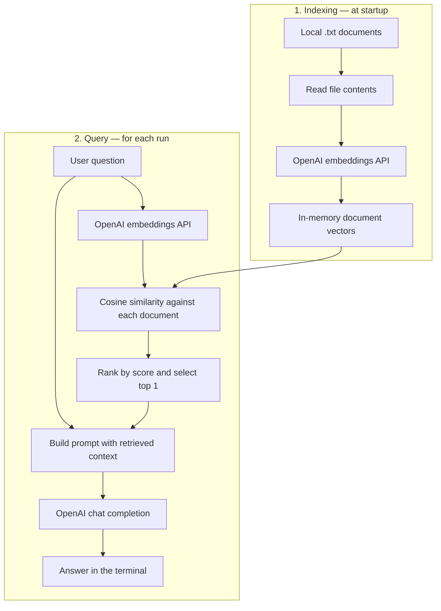

<div align="center">

# RAG from Scratch with TypeScript

**A minimal Retrieval-Augmented Generation implementation, built to understand the mechanics behind RAG — without orchestration frameworks or vector databases.**


</div>

## Overview

This project is a small, hands-on implementation of **Retrieval-Augmented Generation (RAG)** using TypeScript and the OpenAI API. It answers questions about a fictional company's policies by retrieving the most relevant local document and providing that document as context to a language model.

Rather than relying on LangChain or a managed vector database, I implemented the core retrieval steps directly: generating embeddings, computing cosine similarity, ranking documents, and constructing the LLM prompt.

**The goal is to understand how RAG works, not to present a production-ready search system.**

## Architecture



The implementation has two main phases:

- **Indexing:** load the local knowledge base and convert each document into a vector embedding.
- **Retrieval + generation:** embed the question, rank documents by similarity, and ask the LLM to answer using the highest-ranked document.

## How I built it

### 1. Created a small knowledge base

I started with three plain-text files containing fictional company information:

| File                   | Contents           |
| ---------------------- | ------------------ |
| `docs/ferias.txt`      | Vacation policy    |
| `docs/home-office.txt` | Remote-work policy |
| `docs/beneficios.txt`  | Employee benefits  |

Each entire file is treated as **one document**. This keeps the example simple, but means there is no chunking yet.

### 2. Converted documents into embeddings

I used OpenAI's `text-embedding-3-small` model to convert each document into a numerical vector:

```ts
async function embed(text: string): Promise<number[]> {
  const response = await openai.embeddings.create({
    model: "text-embedding-3-small",
    input: text,
  });

  return response.data[0].embedding;
}
```

Embeddings make it possible to compare a question with documents based on learned semantic relationships, even when they do not contain identical words.

The application stores each document's filename, original content, and embedding together **in memory**. It regenerates the embeddings every time the program starts; no persistent index is used.

### 3. Implemented cosine similarity manually

To rank documents, I implemented cosine similarity without a vector-search library:

```ts
function cosineSimilarity(a: number[], b: number[]) {
  const dot = a.reduce((sum, v, i) => sum + v * b[i], 0);
  const normA = Math.sqrt(a.reduce((s, v) => s + v * v, 0));
  const normB = Math.sqrt(b.reduce((s, v) => s + v * v, 0));

  return dot / (normA * normB);
}
```

Cosine similarity measures the alignment between two vectors:

$$
\operatorname{similarity}(a,b) = \frac{a \cdot b}{\lVert a \rVert\lVert b \rVert}
$$

Higher scores indicate more closely aligned vector representations. **A similarity score is not a calibrated probability that a document is relevant.**

### 4. Retrieved the most relevant document

The user's question is embedded with the same model used for the documents. I compare the question vector against every document vector, sort by similarity, and select the highest-ranked result:

```ts
return documents
  .map((doc) => ({
    ...doc,
    score: cosineSimilarity(queryEmbedding, doc.embedding),
  }))
  .sort((a, b) => b.score - a.score)
  .slice(0, 1);
```

This is a **brute-force, top-1 semantic retrieval** strategy. It is easy to inspect and appropriate for three documents, but does not use an approximate-nearest-neighbor index or a relevance threshold.

### 5. Augmented the LLM prompt with retrieved context

Finally, I place the retrieved document's filename and content into the prompt and ask the language model to answer using that context.

The system instruction tells the model to rely on the provided context, say when information is insufficient, and treat documents as data rather than instructions. These instructions help guide behavior but **do not guarantee factual accuracy or complete prompt-injection protection**.

The program prints the selected filename, its similarity score, and the generated answer so the retrieval decision is visible during testing.

## Project structure

```text
rag-from-scratch-typescript/
├── files/
│   ├── benefits.txt
│   ├── vacation.txt
│   └── home-office.txt
├── src/
│   └── index.ts
├── .env.example           # Example configuration (create if needed)
├── .gitignore
├── package.json
├── package-lock.json
├── tsconfig.json
└── README.md
```

> The structure above describes the intended repository layout.

## Getting started

### Prerequisites

- Node.js and npm
- An OpenAI API key with API access and available billing/credits

### Install dependencies

```bash
npm install
```

### Configure your API key

Create a `.env` file in the project root:

```dotenv
OPENAI_API_KEY=your_api_key_here
```

The project loads `.env` through `dotenv/config`. The OpenAI SDK automatically reads `OPENAI_API_KEY` from the environment.

**Never commit your `.env` file or a real API key.**

### Run

```bash
npx tsx src/index.ts "How many days can I work from home?"
```

Example output (illustrative; actual similarity scores and wording may vary):

```text
Documento recuperado: home-office.txt
Similaridade: 0.7...

Resposta: Você pode trabalhar remotamente até 3 dias por semana.
```

Try additional questions:

```bash
npx tsx src/index.ts "How many vacation days do I have?"
npx tsx src/index.ts "What is the meal voucher amount?"
npx tsx src/index.ts "What is the maternity leave policy?"
```

The last question is useful for exploring how the system behaves when the knowledge base does not contain an answer.

## Running with Docker

You can run this project using Docker without installing Node.js or npm locally.

### Prerequisites

- Docker installed and running
- A valid OpenAI API key

### 1. Configure environment variables

```bash
cp .env.example .env
```

Add your OpenAI API key to `.env`:

```env
OPENAI_API_KEY=your_api_key_here
```

### 2. Build the Docker image

```bash
docker build -t rag-from-scratch-typescript .
```

### 3. Ask a question

```bash
docker run --rm --env-file .env rag-from-scratch-typescript "How many vacation days do employees have?"
```

The application will:

1. Load the local knowledge base.
2. Generate embeddings for each document.
3. Generate an embedding for your question.
4. Retrieve the most semantically relevant document using cosine similarity.
5. Generate an answer grounded in the retrieved context.

**Note:** Document embeddings are regenerated on every execution. This is an intentional simplification for educational purposes.

The application uses the OpenAI API, which requires network access and may incur usage costs.

## Design decisions and trade-offs

| Decision                 | Why I chose it                           | Trade-off                                             |
| ------------------------ | ---------------------------------------- | ----------------------------------------------------- |
| Plain-text documents     | Keep ingestion easy to understand        | No PDF/HTML parsing                                   |
| One embedding per file   | Make indexing transparent                | Long or mixed-topic documents can be poorly retrieved |
| In-memory vectors        | Avoid infrastructure during learning     | Recomputed on every run; no persistence               |
| Manual cosine similarity | Understand ranking from first principles | Linear scan across all documents                      |
| Top-1 retrieval          | Keep context selection easy to inspect   | May miss answers spanning multiple documents          |
| No RAG framework         | Expose each step of the pipeline         | More application code to maintain                     |

## Known limitations

This is intentionally a **learning project**, not a production-ready RAG service.

- **No chunking:** a whole document becomes one embedding.
- **No persistence:** embeddings are generated again on every execution, increasing latency and API usage.
- **Top-1 only:** questions requiring information from multiple documents may receive incomplete answers.
- **No relevance threshold:** the retriever returns a document even when none is a good match.
- **No evaluation dataset:** retrieval quality and answer faithfulness are not yet measured systematically.
- **No access controls or robust prompt-injection defenses:** the sample documents are local and trusted for this exercise.
- **No scalable search index:** every query is compared with every stored vector.

## Possible next steps

1. Add chunking and configurable top-k retrieval.
2. Persist embeddings and experiment with PostgreSQL + pgvector.
3. Compare semantic search with keyword and hybrid retrieval.
4. Create a small evaluation dataset and measure retrieval quality.
5. Add automated tests, structured error handling, and observability.
6. Package the CLI with Docker for reproducible execution.

## What I learned

Building this project helped me separate the responsibilities that are often hidden behind RAG frameworks:

- **Embeddings** represent text in a vector space.
- **Retrieval** ranks external information against a user's question.
- **Augmentation** places retrieved evidence into the model's context.
- **Generation** uses the LLM to produce a natural-language answer.

The key insight is that **RAG does not retrain the language model**. It supplies relevant external information at inference time. Retrieval quality, context selection, and generation quality are distinct concerns that must be evaluated separately.

---

<div align="center">

Built as a hands-on exploration of **RAG fundamentals with TypeScript**.

</div>
