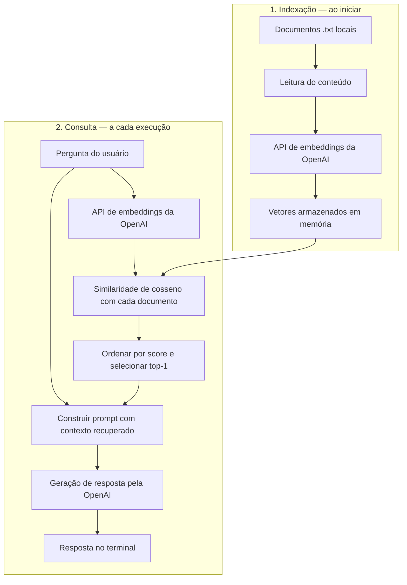

<div align="center">

**Documentação:** [English](README.md) | Português (Brasil)

# RAG do Zero com TypeScript

**Uma implementação minimalista de Retrieval-Augmented Generation (RAG) para entender seus mecanismos fundamentais — sem frameworks de orquestração ou bancos de dados vetoriais.**


</div>

## Visão geral

Este projeto é uma implementação prática e pequena de **Retrieval-Augmented Generation (RAG)** com TypeScript e a API da OpenAI. Ele responde a perguntas sobre as políticas de uma empresa fictícia recuperando o documento local mais relevante e fornecendo seu conteúdo como contexto a um modelo de linguagem.

Em vez de utilizar LangChain ou um banco de dados vetorial gerenciado, implementei diretamente as principais etapas da recuperação: geração de embeddings, cálculo de similaridade de cosseno, ranqueamento dos documentos e construção do prompt enviado ao LLM.

**O objetivo é entender como RAG funciona, não apresentar um sistema de busca pronto para produção.**

## Arquitetura



A implementação possui duas fases principais:

- **Indexação:** carregar a base de conhecimento local e converter cada documento em um vetor de embedding.
- **Recuperação + geração:** gerar o embedding da pergunta, ranquear os documentos por similaridade e solicitar ao LLM uma resposta usando o documento mais bem classificado.

## Como construí o projeto

### 1. Criei uma pequena base de conhecimento

Comecei com três arquivos de texto contendo informações fictícias sobre uma empresa:

| Arquivo                 | Conteúdo                    |
| ----------------------- | --------------------------- |
| `files/vacation.txt`    | Política de férias          |
| `files/home-office.txt` | Política de trabalho remoto |
| `files/benefits.txt`    | Benefícios dos funcionários |

Cada arquivo inteiro é tratado como **um documento**. Isso simplifica o exemplo, mas significa que ainda não existe divisão em trechos (_chunking_).

### 2. Converti os documentos em embeddings

Utilizei o modelo `text-embedding-3-small` da OpenAI para converter o texto de cada documento em um vetor numérico:

```ts
async function embed(text: string): Promise<number[]> {
  const response = await openai.embeddings.create({
    model: "text-embedding-3-small",
    input: text,
  });

  return response.data[0].embedding;
}
```

Os embeddings permitem comparar perguntas e documentos por relações semânticas aprendidas pelo modelo, mesmo quando não compartilham exatamente as mesmas palavras.

A aplicação mantém juntos **o nome do arquivo, seu conteúdo original e o embedding em memória**. Os embeddings são gerados novamente a cada inicialização; não há um índice persistente.

### 3. Implementei manualmente a similaridade de cosseno

Para ranquear os documentos, implementei a similaridade de cosseno sem bibliotecas de busca vetorial:

```ts
function cosineSimilarity(a: number[], b: number[]) {
  const dot = a.reduce((sum, v, i) => sum + v * b[i], 0);
  const normA = Math.sqrt(a.reduce((s, v) => s + v * v, 0));
  const normB = Math.sqrt(b.reduce((s, v) => s + v * v, 0));

  return dot / (normA * normB);
}
```

A similaridade de cosseno mede o alinhamento entre dois vetores:

$$
\operatorname{similarity}(a,b) = \frac{a \cdot b}{\lVert a \rVert\lVert b \rVert}
$$

Scores maiores indicam representações vetoriais mais alinhadas. **Um score de similaridade não é uma probabilidade calibrada de que o documento seja relevante.**

### 4. Recuperei o documento mais relevante

A pergunta do usuário é convertida em embedding com o mesmo modelo usado nos documentos. Comparo o vetor da pergunta com cada vetor armazenado, ordeno os resultados por similaridade e seleciono o primeiro:

```ts
return documents
  .map((doc) => ({
    ...doc,
    score: cosineSimilarity(queryEmbedding, doc.embedding),
  }))
  .sort((a, b) => b.score - a.score)
  .slice(0, 1);
```

Essa estratégia é uma **busca semântica exaustiva (_brute-force_) com recuperação top-1**. É simples de inspecionar e adequada para três documentos, mas não utiliza índice de vizinhos aproximados nem um limiar mínimo de relevância.

### 5. Ampliei o prompt do LLM com o contexto recuperado

Por fim, adiciono o nome e o conteúdo do documento recuperado ao prompt e solicito ao modelo de linguagem que responda com base nesse contexto.

A instrução de sistema orienta o modelo a usar o contexto fornecido, informar quando não houver dados suficientes e tratar os documentos como dados, não como instruções. Essas orientações ajudam a direcionar o comportamento, mas **não garantem precisão factual nem proteção completa contra prompt injection**.

O programa imprime o nome do documento selecionado, seu score de similaridade e a resposta gerada. Assim, é possível observar a decisão de recuperação durante os testes.

## Estrutura do projeto

```text
rag-from-scratch-typescript/
├── files/
│   ├── benefits.txt
│   ├── vacation.txt
│   └── home-office.txt
├── src/
│   └── index.ts
├── .env.example
├── .gitignore
├── Dockerfile
├── .dockerignore
├── package.json
├── package-lock.json
├── tsconfig.json
├── README.md
└── README.pt-BR.md
```

> A estrutura acima representa a organização esperada do repositório. Confira os nomes dos arquivos no seu projeto antes de publicar.

## Como executar localmente

### Pré-requisitos

- Node.js e npm
- Uma chave válida da API da OpenAI, com acesso à API e créditos ou faturamento disponíveis

### Instale as dependências

```bash
npm install
```

### Configure sua chave de API

Crie um arquivo `.env` na raiz do projeto:

```dotenv
OPENAI_API_KEY=sua_chave_aqui
```

O projeto carrega o `.env` por meio de `dotenv/config`. O SDK da OpenAI lê automaticamente a variável de ambiente `OPENAI_API_KEY`.

**Nunca faça commit do `.env` nem de uma chave real.**

### Execute

```bash
npx tsx src/index.ts "Quantos dias posso trabalhar de casa?"
```

Exemplo de saída (ilustrativo; o score e a redação da resposta podem variar):

```text
Documento recuperado: home-office.txt
Similaridade: 0.7...

Resposta: Você pode trabalhar remotamente até 3 dias por semana.
```

Experimente outras perguntas:

```bash
npx tsx src/index.ts "Quantos dias de férias tenho?"
npx tsx src/index.ts "Qual é o valor do vale-refeição?"
npx tsx src/index.ts "Qual é a política de licença-maternidade?"
```

A última pergunta é útil para observar como o sistema se comporta quando a base de conhecimento não contém a resposta.

## Executando com Docker

É possível executar o projeto com Docker sem instalar Node.js ou npm localmente.

### Pré-requisitos

- Docker instalado e em execução
- Uma chave válida da API da OpenAI

### 1. Configure as variáveis de ambiente

```bash
cp .env.example .env
```

Adicione sua chave ao `.env`:

```dotenv
OPENAI_API_KEY=sua_chave_aqui
```

### 2. Construa a imagem Docker

```bash
docker build -t rag-from-scratch-typescript .
```

### 3. Faça uma pergunta

```bash
docker run --rm --env-file .env rag-from-scratch-typescript "Quantos dias de férias os funcionários têm?"
```

A aplicação irá:

1. Carregar a base de conhecimento local.
2. Gerar embeddings para cada documento.
3. Gerar um embedding para sua pergunta.
4. Recuperar o documento semanticamente mais relevante usando similaridade de cosseno.
5. Gerar uma resposta com base no contexto recuperado.

**Observação:** os embeddings dos documentos são gerados novamente a cada execução. Essa é uma simplificação intencional para fins de aprendizado.

A aplicação usa a API da OpenAI, exige conexão com a internet e pode gerar custos de utilização.

## Decisões técnicas e trade-offs

| Decisão                        | Por que escolhi                                       | Trade-off                                                          |
| ------------------------------ | ----------------------------------------------------- | ------------------------------------------------------------------ |
| Documentos de texto simples    | Facilitar o entendimento da ingestão                  | Sem processamento de PDF ou HTML                                   |
| Um embedding por arquivo       | Tornar a indexação transparente                       | Documentos longos ou com vários assuntos podem ser mal recuperados |
| Vetores em memória             | Evitar infraestrutura adicional durante o aprendizado | Sem persistência; embeddings recalculados a cada execução          |
| Similaridade de cosseno manual | Entender o ranqueamento desde os fundamentos          | Comparação linear com todos os documentos                          |
| Recuperação top-1              | Facilitar a inspeção da seleção de contexto           | Pode perder respostas distribuídas em vários documentos            |
| Sem framework de RAG           | Deixar cada etapa do pipeline explícita               | Mais código de aplicação para manter                               |

## Limitações conhecidas

Este é intencionalmente um **projeto de aprendizado**, não um serviço RAG pronto para produção.

- **Sem chunking:** cada documento inteiro gera um único embedding.
- **Sem persistência:** os embeddings são recalculados a cada execução, aumentando a latência e o uso da API.
- **Apenas top-1:** perguntas que dependem de vários documentos podem receber respostas incompletas.
- **Sem limiar de relevância:** o retriever retorna um documento mesmo quando nenhum é uma boa correspondência.
- **Sem dataset de avaliação:** a qualidade da recuperação e a fidelidade das respostas ainda não são medidas sistematicamente.
- **Sem controle de acesso ou defesas robustas contra prompt injection:** os documentos do exemplo são locais e considerados confiáveis para este exercício.
- **Sem índice de busca escalável:** cada pergunta é comparada com todos os vetores armazenados.

## Próximas melhorias possíveis

1. Adicionar chunking e recuperação top-k configurável.
2. Persistir embeddings e experimentar PostgreSQL com pgvector.
3. Comparar busca semântica, busca por palavras-chave e busca híbrida.
4. Criar um pequeno dataset de avaliação e medir a qualidade da recuperação.
5. Adicionar testes automatizados, tratamento estruturado de erros e observabilidade.
6. Aprimorar a execução em Docker e a validação automatizada do projeto.

## O que aprendi

Construir este projeto me ajudou a separar responsabilidades que muitas vezes ficam escondidas atrás de frameworks de RAG:

- **Embeddings:** representam textos em um espaço vetorial.
- **Retrieval:** ranqueia informações externas em relação à pergunta do usuário.
- **Augmentation:** insere as evidências recuperadas no contexto do modelo.
- **Generation:** utiliza o LLM para produzir uma resposta em linguagem natural.

O principal aprendizado é que **RAG não retreina o modelo de linguagem**. Ele fornece informações externas relevantes durante a inferência. A qualidade da recuperação, a seleção de contexto e a qualidade da geração são aspectos distintos que precisam ser avaliados separadamente.

---

<div align="center">

Desenvolvido como um estudo prático dos **fundamentos de RAG com TypeScript**.

</div>
